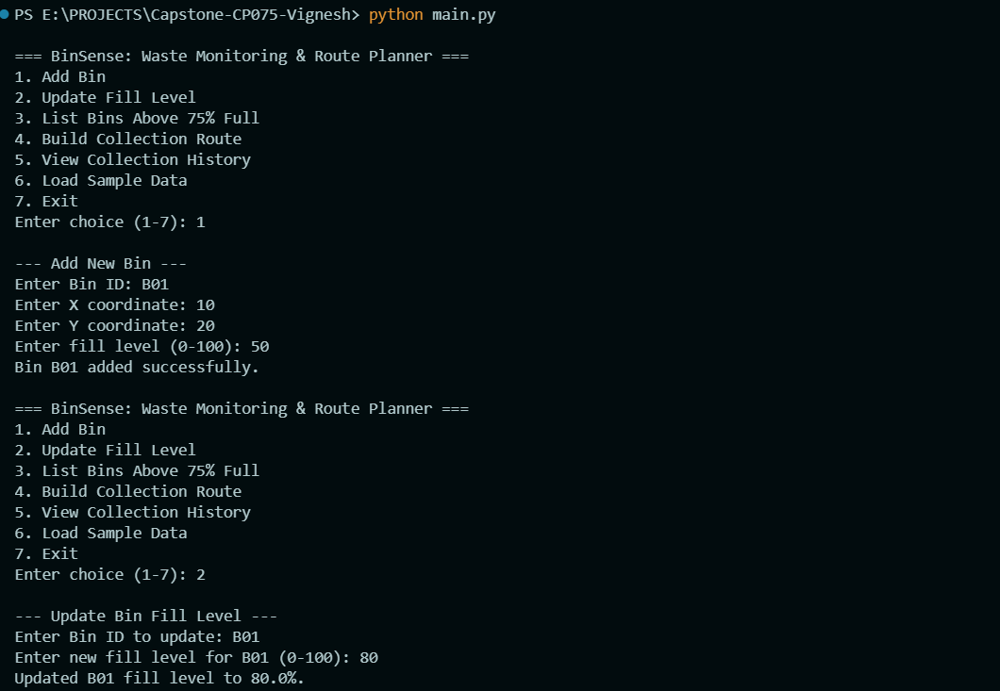
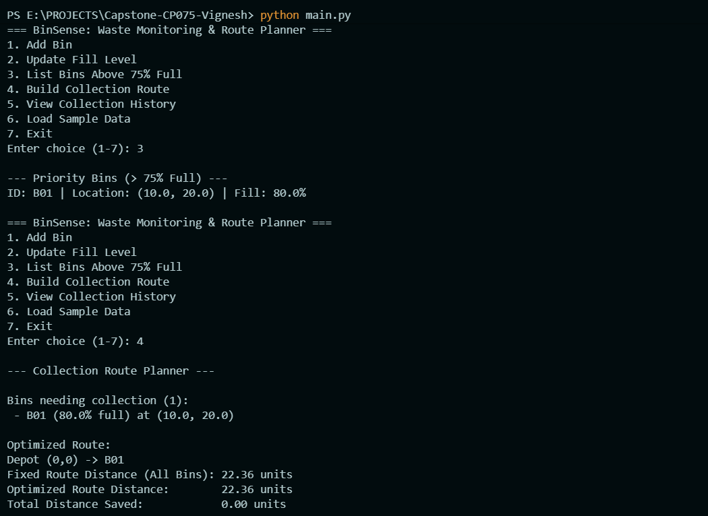
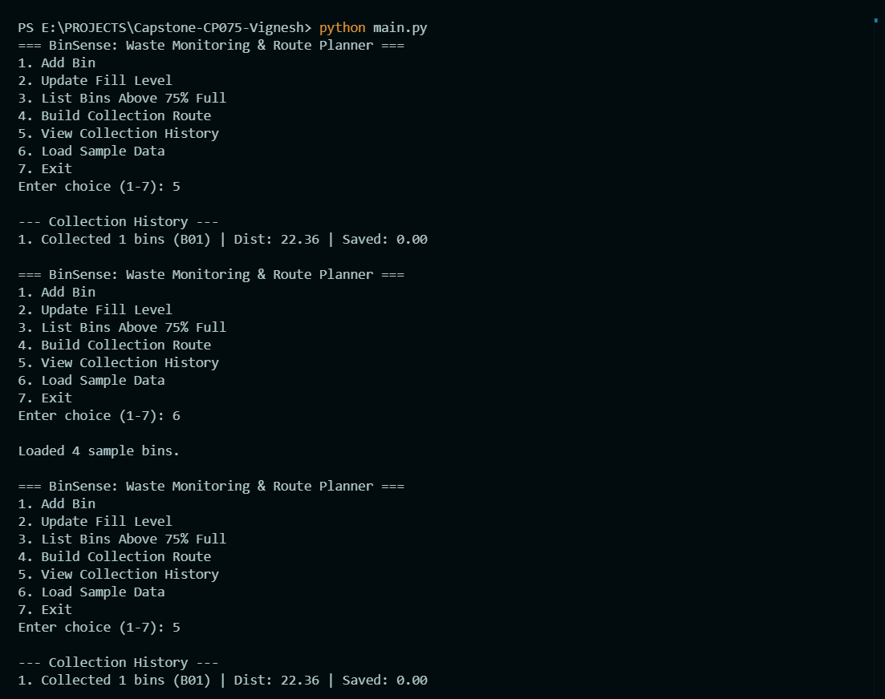
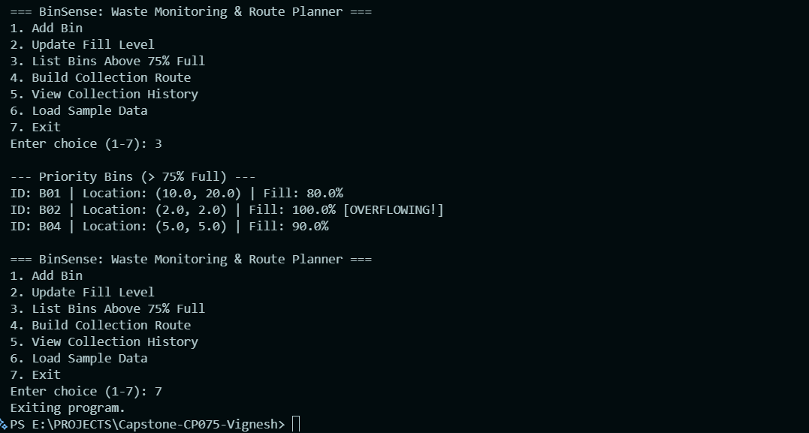

# CP075  BinSense: Smart Waste Monitoring and Collection Route Planner
## Team
Vignesh S Suvarna (1AT24CS251),T Chiru Mounika(1AT24CS235)
##
How to run
python main.py
## Features that work

1. Record bins with location (x, y) and fill level (Core Feature 1)
2. Update bin fill levels (Core Feature 2)
3. List bins above 75 percent full (Core Feature 3)
4. Build a collection route visiting only bins above 75% full using nearest-neighbour routing (Core Feature 4)
5. Alert on overflowing bins (100% full) and keep a history of collections (Core Feature 5)
6. Calculate the route distance saved against visiting every bin (Stretch Feature)
7. Save collection history to a text file `route_history.txt` (Stretch Feature)
8. Load sample bin data for quick testing and demonstration
## sample Run

